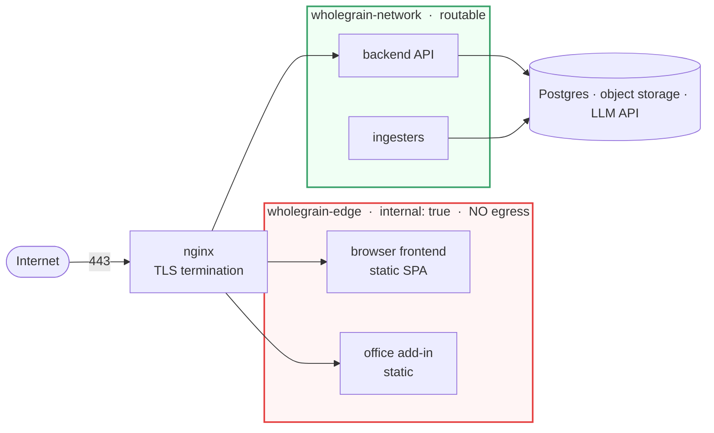

<p align="center">
  
</p>

<h1 align="center">Wholegrain Finance — Investment Ontology</h1>

**An open-source data model and toolkit for investment holdings, funds and family offices.**

Most portfolio tooling is either a spreadsheet that eventually collapses under its own
weight, or a closed platform that decides for you what an "investment" is. Wholegrain is
the middle path: a small, explicit ontology you run on your own infrastructure, with
modules you add only if you need them.

The ontology is the product. Everything else — extraction, search, agents, reporting — is
a module that reads and writes these four tables.

---

## The ontology

Four tables carry the whole domain. Every module reads and writes these; nothing else is
load-bearing.

```
entities ──────subject/object── transactions ──event_id── events
       │                                                      │
       └──────────────── measurements ────────────────────────┘
```

**Transactions are flows, measurements are marks, events are narrative.** A holding's
*cost* is built from transactions (what was paid), its *value* from measurements (what
one unit is worth now), and the two are computed independently and shown side by side.
Events explain what happened; nothing is ever summed from them.

### `entities`

Every party, asset and account is a row here — the thing you own, the thing you owe, the
counterparty you pay, and the bank account the money sits in.

Not `legal_entities`: a bank account, a property and a loan balance are none of them
legal persons, and accounts are the most trafficked rows of all — every bank line
names one. The table holds whatever a transaction can point at; `type` and
`structure_type` say what each one is. The id is a readable slug
(`northwind_holding_gmbh`), unique per workspace, so ledger rows are legible without
joins.

| `type` | |
|---|---|
| `private_company` | operating company, unlisted |
| `listed_equity` | listed position |
| `fund` | fund interest (LP position) |
| `real_estate_fund` | property fund |
| `real_estate` | direct property |
| `spv` | special-purpose vehicle |
| `crypto_asset` | digital asset |
| `cash_account` | a bank or custody account |
| `payable_receivable` | a loan, mortgage or intra-group balance |
| `service_provider` | lawyers, auditors, agents |
| `individual` | a natural person |
| `other` | classified, and none of the above fits |

The database also admits a handful of legacy spellings that real data arrived with —
`portfolio_company` (= `private_company`), `account` (= `cash_account`), `counterparty`,
`entity` — so that no existing row had to be rewritten to pass the constraint. New
rows should use the canonical values above. `NULL` means "not classified yet".

`structure_type` is orthogonal and has exactly two values: **`holding`** (a vehicle you
own things *through*) and **`asset`** (a thing you own).

> **Type is what a thing is, not the part it plays.** A law firm is a
> `service_provider`; it *acts as* a counterparty when you pay it. Role is already
> expressed by which foreign key points at the row.

> **Model bank accounts as entities.** A cash account is a first-class `entities` row, not
> a field on a transaction. That is what lets a payment name *which* account it moved on,
> and lets you reconcile per account against a statement.

Entities also carry:

- **`contacts`** — one checked object, not a free list (migration 0021):

  ```jsonc
  {
    "people":   [{ "name": "Jane Doe", "organisation": "Northwind Holding GmbH",
                   "function": "CFO", "email": "jane.doe@example.com", "primary": true }],
    "channels": [{ "kind": "postal", "value": "1 Example Street, Springfield", "label": "Registered office" }],
    "portals":  [{ "name": "Investor portal", "url": "https://portal.example.com",
                   "status": "active", "credential_ref": "vault:northwind-portal" }],
    "how_to_reach": "Capital calls arrive through the portal; questions go to IR."
  }
  ```

  Every level refuses unknown keys, which is also what keeps secrets out: a portal
  has a `credential_ref` (where the secret lives), never a password field.
- **`accounting_system_ref`** — the account number the entity is booked under in your
  bookkeeping. A string, because account numbers carry spaces and leading zeros; not
  unique, because one account can hold several entities and an entity can move.
- **`group_id`** → `entity_groups`, for netting a property against its mortgage.

### `events`

The economic thing that happened. One event can own several transactions — that is how a
single investment ties its cash leg to its share leg.

`investment` · `divestment` · `capital_call` · `distribution` · `exit` ·
`commitment` · `valuation` · `reporting` · `governance` · `financing_round` ·
`external_financing` · `dividend` · `invoice` · `news` · `general_information` · `other`

`exit` is the *company's* liquidity event — trade sale, IPO, the whole cap table
exits together. `divestment` is *you* selling out of a position that continues
without you. Likewise `financing_round` is the company's event and `investment`
is your participation in it: one round can carry several of your investments
across vehicles.

`news` and `general_information` carry no money and no transactions.

### `transactions`

**A transaction is an exchange, not a cashbook line.** This is the part most models get
wrong, so it is worth stating plainly.

Each transaction has two legs, booked from the point of view of the **subject** (whose
books you are on) against the **object** (the counterparty or asset). Each leg says
*how much* and *of what unit*:

```
outflow_amount / outflow_type / outflow_reporting_amount   ← what the subject gives
inflow_amount  / inflow_type  / inflow_reporting_amount    ← what the subject receives
```

`*_type` is a **unit**, not a category. `EUR` means euros. `series_a2` means Series A2
shares. So:

| | outflow | inflow |
|---|---|---|
| Paying a law firm €56.88 | `56.88 EUR` | `service` *(no amount — a service has none)* |
| Buying 69 Series A2 shares for €49,828.35 | `49828.35 EUR` | `69 series_a2` |
| Capital call €43,269.92 into a fund | `43269.92 EUR` | `fund_interest` |
| FX transfer between own accounts | `50000 EUR` | `47800 CHF` |
| Distribution of €10,000 received | `-10000 EUR` | — |
| Exit: selling 1,000 Series A for €30,000 | `-30000 EUR` | `-1000 series_a` |

**Amounts are signed.** `+` on the money leg means the subject pays, `−` means it
receives — a distribution is a *negative outflow*, never cash moved onto the inflow
leg. The inflow leg is a **count of units**, and it is signed too: an exit gives
units up, so its `inflow_amount` is negative. A position's unit count is then simply
the signed sum of its inflow legs, and its cost the signed sum of its money legs.

`*_reporting_amount` is the same leg normalised to your reporting currency. It is null
on a leg that has no monetary value, such as shares or a service — and null is
*unknown*, never zero.

**Units.** A leg is an upper-case ISO-4217 currency (`EUR`, `USD`), or a lower-case
slug naming an instrument (`common`, `ordinary`, `series_seed`, `series_a2`,
`pre_seed`, `lp_interest`, `fund_interest`, `safe`, `cla`, `convertible_note`, `loan`,
`warrant`, `option`, `crypto`, `service`, …). The database enforces exactly that shape —
`^[A-Z]{3}$` or `^[a-z][a-z0-9_]*$` — and rejects spaces, punctuation and prose, so
`69 Series A2 Shares (nos. 60,467-60,535)` cannot land in the column.

It is a pattern rather than a list on purpose: a share class is named by whoever
issues it, and the next financing round will invent another. Equity classes stay
**granular**: liquidation seniority and price are per class, so collapsing them to one
`equity` value makes a waterfall uncomputable and loses real prices. `equity` remains
admitted as the honest fallback where no document states the class. A contract that is
its own unit (`safe`, `cla`, `convertible_note`, `loan`) counts as one.

`type` records **why**, not **how**. It is free text since migration 0010 — it is the
extension point modules use to tell their own kinds of movement apart — with one
exception the database refuses: `bank_wire` (bank lines are `cashflows`, below). The
shared vocabulary:

| | |
|---|---|
| position flows — build cost and unit count | `investment` · `capital_call` · `transfer` · `exit` · `distribution` |
| commitments — notional, never cost | `commitment` |
| other money | `invoice` · `fee` · `dividend` · `interest` |
| instrument change | `conversion` |
| catch-all | `other` |

The payment rail (wire, SEPA, card) belongs in `add_data.rail`; a firm's own label
belongs in `classification`.

**A transaction is an exchange — if nothing changes hands it is not one.** An asset
going to zero moves no money, so the value change is a `fair_value = 0` measurement,
not a transaction. `conversion` stays for the opposite reason — a SAFE converting to
equity gives up the note and receives shares.

**Commitments** are transactions of type `commitment`: money promised, not yet paid.
They are tracked as committed capital and kept out of cost; their `status` carries the
contract lifecycle (`intent` → `signed` → `closed` → `outdated`), separately from calls
and distributions (`planned` → `expected` → `issued`) and spot flows (`executed`).
Status is always a separate axis from type.

### `measurements`

Periodic numeric facts about an entity. One row shape covers two different things,
told apart by a single column, `instrument_type`:

| `instrument_type` | the row is | `metric_name` | `unit` |
|---|---|---|---|
| `NULL` | a **company KPI** | `revenue` `ebitda` `gross_margin` `arr` `mrr` `headcount` `cash` `runway` `nrr` `churn` … | a currency, `%`, `count`, `FTE`, `months` |
| set (`series_a2`) | an **instrument valuation** | `fair_value` `nav` `capital_account_value` `share_price` | the currency of the price |

**A valuation is the price of ONE unit, never a total.** It mirrors the transaction it
prices — `instrument_type` is the unit priced, exactly as `inflow_type` is; `unit` is
the currency of the price, exactly as `outflow_type` is; `value` is the price of one:

```
transaction   inflow_type=series_a2   inflow_amount=69     outflow_type=EUR  outflow_amount=49828.35
valuation     instrument_type=series_a2                    unit=EUR          value=1453
```

Everything else is derived: the holding is **units × price**. A valuation finds its
holding by matching the same instrument on both sides — transaction
`(object_id, inflow_type)` = measurement `(subject_id, instrument_type)` — and a price
belongs to the instrument, not to a holder, so it carries none. Several classes worth
the same on one day are several rows, one per class.

A document that states only a total is divided by its count before it is written. A
total that cannot be divided is stored as **`<metric>_total`** (`fair_value_total`,
`nav_total`, `capital_account_value_total`) — kept as information, never a valuation,
never multiplied by anything. No count, no price: a blank value is *unknown*, which is
a different fact from a written-off position whose `fair_value` is a real `0`.

**Ownership** is units held ÷ units in issue. The numerator comes from the
transactions, which already name both parties. The denominator is a
**`shares_outstanding`** measurement on the issuer, because a ledger records what you
bought and never what exists. Units need not be shares: where only a percentage is
known, the stake is carried as 8 units out of 100, so a fund interest or a partnership
share uses the same arithmetic. The `unit` on `shares_outstanding` declares which scale
is in force — **`shares`** or **`percent_scale`** — and there is one scale per issuer:
mixing a synthetic 8 with a real 5,436 destroys the number while looking like nothing.

`cost_basis`, `moic` and `ownership_pct` are not valuations and are never shown as one.
Performance figures (IRR, TVPI, DPI) are deliberately not stored: the dated cashflow and
value series are, so downstream tools compute them consistently.

---

## Beside the four

These resources live next to the ontology and are never summed into a holding.

**`cashflows` — bank statement lines.** A bank line is an *observation* (what the bank
says happened on an account); a transaction is the *interpretation* (what it was,
economically). They used to share a table and were split, for two reasons. Permissions
are granted per resource, so only a separate resource can say "anyone may record an
investment, only an admin may record a bank line" — `cashflows` is **admin-write,
member-read**, and an agent (which carries a member's rights) can read them but never
invent one. And the shape never fit: a bank line is *one signed amount* on one account
(`amount`, `currency`, `booking_date`, `value_date`, `counterparty_raw`, `purpose`, …),
with no instrument leg and no event. **`cashflow_settlements`** links a cashflow to the
transaction(s) it paid, many-to-many with an attributed amount, because one wire pays
several invoices and one investment is paid in tranches.

**Source files on every row.** Each ontology record cites the documents it was read
from through a link table with real foreign keys — `entity_files`, `event_files`,
`transaction_files`, `measurement_files`, `cashflow_files` — each row a `file_id` plus a
`ref_name` saying *where* in the document the fact is ("Capital call no. 7, page 2").
The database refuses a link to a file outside the record's workspace. In the API this is
the `references: [{file_id, ref_name}]` field on every record.

**`tasks`** — a per-item work ledger: one row per unit of work (an ingested email, a
document request, a process stage), with `agent_name` (who works on it), `type` (what
kind of work), `status` (where in its lifecycle) and `result` (what came out). Tasks
nest one level (`parent_task_id`), carry attached files and an **append-only comment
thread** (`comments`).

**`groups`** — a cross-type label that tasks, events, transactions and measurements can
all carry (`group_id`). One group can hold the requests of a year-end close together
with the bookings and valuations that came out of it. A group of tasks is a **request
list** (`GET /tasks/requests` returns it in one round trip, with documents, comments and
linked records) and, with stage tasks, a **process**. A group may define which
**columns** its request list shows (`groups.columns`, migration 0022). Not to be
confused with `entity_groups`, which only groups entities.

---

## Extending it

Two escape hatches, so you never have to fork the schema:

- **`add_data`** — a `jsonb` column on every table. Firm-specific facts live here: value
  dates, wire references, FX rates, the verbatim source row. Promote a key to a real
  column once you filter on it constantly.
- **Modules** — anything that reads the four tables. Add only what you need.

**Keep your own vocabulary out of the shared `type` fields.** Use `classification` or
`add_data` for firm-specific labels. Folding them into `type` is how a taxonomy quietly
drifts until reporting across entities stops working. `transactions.type` is free text
precisely so a module *can* add a kind of movement — do it deliberately, by name, and
filter on it where you read it.

---

## Architecture

```
                     ┌──────────────────────── WHOLEGRAIN CORE ────────────────────────┐
                     │                                                                 │
 browser ── nginx ──►│  frontend (static SPA)                                          │
 CLI     ──  TLS  ──►│  backend API ── RBAC matrix ── Postgres + pgvector              │
 Claude  ──       ──►│  MCP server (/mcp/<ws>)          row-level security             │
 agents  ──       ──►│                                  object storage (documents)     │
                     └───────────────────────────────────────▲─────────────────────────┘
                                                             │ writes folders · files ·
                                                             │ file_extractions · tasks
                                                             │ + document blobs
                     ┌───────────────────────────────────────┴─────────────────────────┐
                     │  DOCUMENT INGESTION & EXTRACTION — one of:                       │
                     │   (a) the built-in pipeline image: sync → extract → label →      │
                     │       chunk/embed                                                │
                     │   (b) an external document service of your own                   │
                     └─────────────────────────────────────────────────────────────────┘
```

**The core** is:

- **PostgreSQL with pgvector** — the single source of truth. Tenant isolation is
  enforced here, by row-level security, not in application code: every workspace table
  carries policies, and a role that cannot see a row cannot write it either.
- **The backend API** (FastAPI). Every request passes three independent checks: an
  **RBAC matrix** (`role_permissions`: create/read/update/delete per role and resource,
  default-deny) decides *what* a role may do; **RLS** decides *which rows* it sees; and
  workspace ownership gates the few owner-only actions (membership, settings). A human
  and an agent are the same kind of principal — an agent is a user with a role, and
  nothing in the code branches on "is this an agent". Migrations run on container start.
- **The browser frontend** — a static React build, configured at container start, no
  Node runtime in the shipped image.
- **The CLI** — the whole API from a terminal, generated from the API's OpenAPI document
  at runtime, with a read lane (`wholegrain sql`, read-only SQL under the caller's RLS)
  and a write lane (`wholegrain call`, every write with a reason on the audit trail).
- **The MCP server**, mounted in the API at `/mcp/<workspace-id>`: OAuth 2.1, one
  workspace per connection, read tools plus a narrow set of attributed write tools. The
  [`claude-plugin/`](claude-plugin/) in this repository connects Claude Code to it.
- **Agents** — packages that turn source material into ontology rows proposed for
  human review, writing through the API like any other client.

**Document ingestion and extraction are deliberately outside the core**, and can be
either of two things:

- **(a) The built-in pipeline image** (`Dockerfile.pipeline` in the backend repo). A
  batch job, not a service: it mirrors a directory tree into `folders`/`files` and
  object storage, extracts text into `file_extractions` (Docling), labels documents,
  and builds search chunks and embeddings in `file_chunks`. Run it on demand or from
  cron.
- **(b) An external document service** that writes into the same tables — `folders`,
  `files`, `file_extractions` (and `tasks`, one per ingested email or message) — and
  into the same object-storage layout. Use this when extraction needs GPUs, a paid OCR
  API or connectors that do not belong in your core install.

Either way the contract is the schema: **Wholegrain only reads what the document side
writes.** It never needs to know which one produced a row.

Search runs in the database as one function, `app.search()`, which fuses full-text,
vector and filename matches with Reciprocal Rank Fusion. The query embedding is computed
by the caller; without an embeddings provider search degrades to lexical-only hybrid
rather than failing.

### Network topology

Static frontends get **no route to the internet**. They serve files; the browser
talks to the API directly, so the container itself never needs egress.



nginx is the only member of both networks, and it creates the edge network that the
frontends then join as `external: true` — so it starts before them.

Why bother: a static container that cannot make outbound connections cannot
fetch a payload. A compromise on a sibling host used outbound HTTP to pull a
cryptominer and reach a mining pool; on an `internal: true` network both steps
fail, which turns a foothold into a dead end rather than merely a smaller one.
`internal: true` still permits Docker's embedded DNS and traffic between members,
so nginx reaches the frontends normally. It does not permit published host ports:
Docker configures no gateway on an internal network, so a `ports:` mapping on a
member silently does nothing — those containers are reachable only through nginx.

---

## Repositories

This repository is the umbrella: the overview, the deployment guide, the schema and
security write-ups, and the Claude Code plugin. The components live in their own
repositories under [github.com/wholegrainfinance](https://github.com/wholegrainfinance).
Some of them are not public yet; where a link does not open, the repository is still
private.

| Repository | What it is | Read first |
|---|---|---|
| [`backend`](https://github.com/wholegrainfinance/backend) | FastAPI API: auth, workspaces, the ontology CRUD/query/bulk surface, RBAC, hybrid search, MCP server, feature modules (portfolio, mirror, …). Alembic migrations, the RLS role setup, and the optional pipeline image. | `docs/ARCHITECTURE.md` · `docs/DATABASE_SCHEMA.md` · `docs/FRONTEND_ONTOLOGY_API.md` · `docs/FRONTEND_MEASUREMENTS_API.md` · `docs/FRONTEND_TASKS_API.md` · `docs/RETRIEVAL.md` · `docs/DB_ROLES_AND_RLS.md` · `docs/MIRROR.md` |
| [`browser-frontend`](https://github.com/wholegrainfinance/browser-frontend) | React/Vite dashboard: ledger views, holdings, organigram, tasks and request lists, document explorer, search. Static build, configured at container start. | `docs/HOLDINGS_HANDBOOK.md` — how every holdings figure is computed |
| [`nginx`](https://github.com/wholegrainfinance/nginx) | TLS termination and reverse proxy. Domains and upstreams come from `.env` and are rendered into vhost templates at start; creates the egress-free `wholegrain-edge` network. | `README.md` |
| [`cli`](https://github.com/wholegrainfinance/cli) | `wholegrain` command line over the whole API, generated from OpenAPI at runtime; read lane (`sql`) and write lane (`call`), token refresh, workspace mirror client. Standard library only. | `README.md` |
| [`agents`](https://github.com/wholegrainfinance/agents) | Agents that write ontology rows: `ontology-writer` (ingested email/message → proposed entities, events, transactions, measurements, behind a deterministic gate) and a `qa` agent. | `README.md` |
| [`database`](https://github.com/wholegrainfinance/database) | PostgreSQL 16 + pgvector image with the extensions the schema needs (`vector`, `pg_trgm`, `btree_gin`), tuning via env, backup and restore scripts. Optional — a managed server works too. | `README.md` |

---

## Requirements

- A cloud account (or your own hardware)
- A VM — 2 vCPU is enough to start; more RAM if you build frontends on the same box
- PostgreSQL 16 with `vector`, `pg_trgm` and `btree_gin` — managed, or the `database` module
- Object storage — S3-compatible or Azure Blob
- An LLM / embeddings API key, only for the optional agent, labelling and embedding modules

## Install

**[DEPLOYMENT.md](DEPLOYMENT.md) is the full walkthrough** — the steps below are
the shape of it. Several of them are circular if taken in the wrong order, and a
few failure modes are silent, so it is worth following rather than improvising.

1. Clone the modules you want: **nginx**, **backend**, **browser-frontend**, and
   **database** if you are not using a managed server
2. Point two DNS names at the host — one for the API, one for the dashboard
3. Issue certificates, one per host, with port 80 free
4. Create the shared `wholegrain-network`, then bring up **nginx**: it creates the
   egress-free network the frontends join
5. Provision PostgreSQL — a managed server, or the **database** module
6. Run the migrations as the database **owner** (the backend container does this on
   start; the first time, do it once by hand)
7. **Create the RLS login roles** and point the API at `app_api`, *not* the owner
   — an owner bypasses row-level security, and nothing about that looks wrong
8. Provision object storage, and choose a bucket layout — it is fixed at install
9. Fill in the `.env` files, start backend and frontend, register the first account
10. Bootstrap the first admin with one SQL statement — role assignment is itself
    admin-only, so it cannot be done through the API until someone holds the role.
    Everything after that is API-only
11. Optionally add document ingestion: the pipeline image, or your own service
12. Apply the hardening below — do not skip it

## Hardening

- **Lock the database to known addresses.** No public firewall rule, no
  "allow all cloud services" — on most providers that admits *every* customer, not just
  you. Prefer a private endpoint.
- **Terminate HTTPS properly** and redirect all plain HTTP.
- **Put a WAF or CDN in front** (cloud front door, Cloudflare) to absorb brute-force and
  bot traffic before it reaches your VM.
- **Keep compute and database in the same region.** A cross-region split adds ~100 ms to
  every query and will dominate your latency budget long before your hardware does.
- **Put static frontends on an egress-free network** — see
  [Network topology](#network-topology). A container that serves files needs no
  outbound access, and denying it turns a compromise into a dead end.
- Keep admin access on a VPN or bastion; do not expose management ports.

---

## Reference

- **[DEPLOYMENT.md](DEPLOYMENT.md)** — a first deployment end to end: ordering,
  certificates, tenant isolation, storage layout, document ingestion, copying a
  workspace between servers, and the failure modes that are silent.
- **[DATABASE.md](DATABASE.md)** — the schema: tables, relationships, row-level
  security, search internals, index costs and known warts.
- **[SECURITY.md](SECURITY.md)** — what the shipped configuration hardens, what
  it deliberately does not, and why each control exists.
- **[claude-plugin/](claude-plugin/)** — query and work on a workspace from Claude Code.

## Status

Early. The ontology is in production use; the docs here describe the model rather than a
packaged release. Issues and discussion welcome.

## License

[Apache 2.0](LICENSE).
